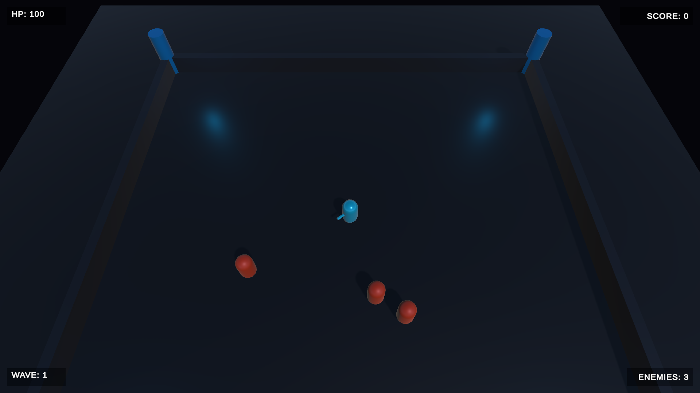
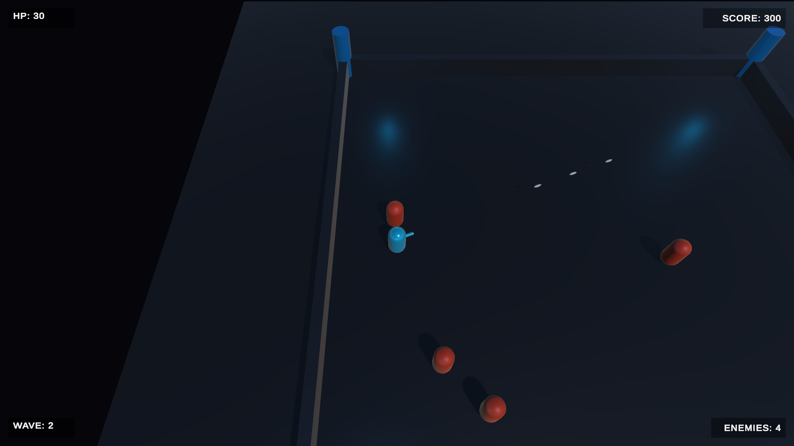
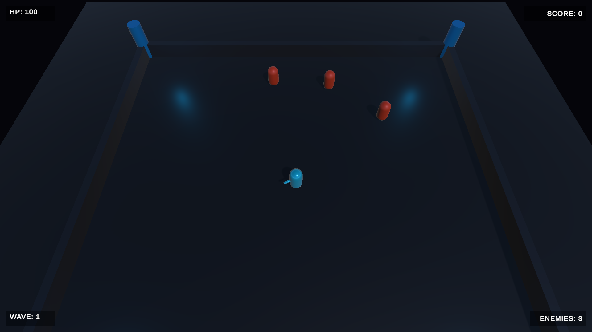
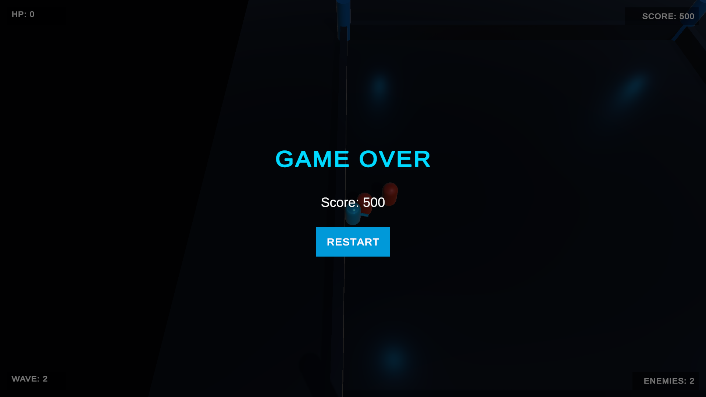
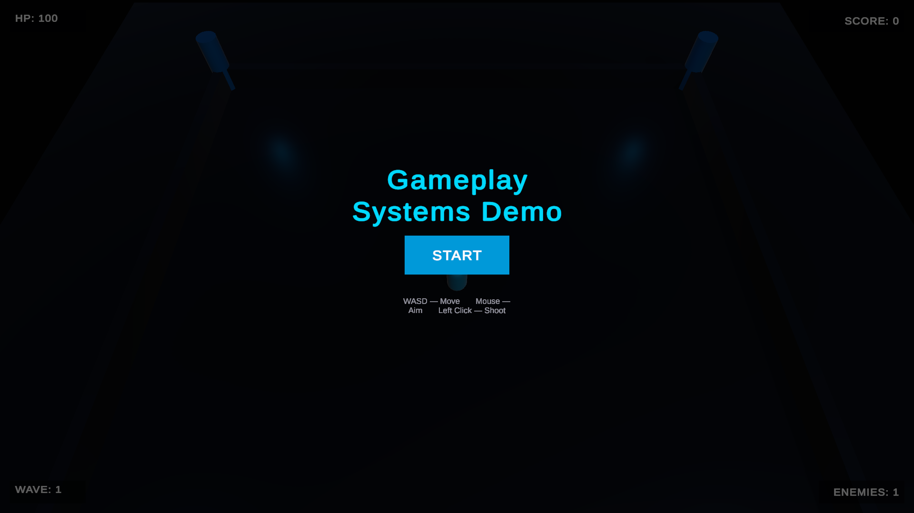

# Unity Gameplay Systems Demo

A focused portfolio project demonstrating practical **Unity gameplay programming** and **C# systems architecture**. Built to showcase real-world skills in game development — not a commercial game, but a clean, readable, maintainable codebase that highlights what a professional Unity developer delivers.

---

## Overview

This project is a top-down arena shooter built with Unity 2021.3.33f1. It demonstrates core gameplay systems implemented cleanly with a component-based architecture: player control, combat, enemy AI, wave-based spawning, health/damage, HUD, camera follow, and full game-state management — all in a single cohesive scene.

---

## Features

| System | Description |
|---|---|
| **Player Movement** | WASD / Arrow Keys, physics-based Rigidbody movement |
| **Mouse Aiming** | Player rotates to face the mouse cursor via ground-plane raycast |
| **Projectile Shooting** | Left-click fires projectiles from a forward-facing fire point |
| **Enemy Chase AI** | Enemies locate and pursue the player using Rigidbody movement |
| **Health & Damage** | Player and enemies have independent health components with damage logic |
| **Hit Feedback** | Enemies flash on hit; impact burst effect on projectile contact |
| **Death Effects** | Particle burst on enemy death |
| **Muzzle Flash** | Brief particle effect at the fire point on each shot |
| **Enemy Spawning** | Enemies spawn at randomised positions around the arena boundary |
| **Progressive Waves** | Each wave increases enemy count; next wave triggers after all enemies are defeated |
| **Score System** | Score increments per enemy kill; displayed live in the HUD |
| **Player Health** | Player takes contact damage from enemies; triggers Game Over at zero HP |
| **Gameplay HUD** | Live readout of HP, Score, Wave, and Enemy count at screen corners |
| **Start Screen** | Title screen with controls reference; gameplay begins on player input |
| **Wave Announcement** | Fading "WAVE X" text displayed at each wave transition |
| **Game Over Screen** | Displays final score; RESTART returns to the Start screen |
| **Smooth Camera Follow** | LateUpdate lerp follow preserving the top-down angle and arena framing |

---

## Technical Implementation

### Core Scripts

```
Assets/Scripts/
├── Core/
│   ├── GameManager.cs        — Singleton; owns score and game-state (playing / game over / restart)
│   └── CameraFollow.cs       — Smooth LateUpdate camera follow with configurable offset and smoothness
├── Player/
│   ├── PlayerController.cs   — Reads WASD input; moves player via Rigidbody.MovePosition
│   ├── PlayerShooter.cs      — Mouse-aim raycast; instantiates Projectile prefab on click
│   └── PlayerHealth.cs       — Tracks player HP; calls GameManager.GameOver() on death
├── Combat/
│   └── Projectile.cs         — Self-propelled via Transform.Translate; triggers EnemyHealth.TakeDamage on contact
├── Enemy/
│   ├── EnemyController.cs    — Finds Player by tag; pursues via Rigidbody.MovePosition; contact damage with cooldown
│   ├── EnemyHealth.cs        — Tracks enemy HP; fires OnHit / OnDeath events; awards score on death
│   └── EnemySpawner.cs       — Coroutine-driven wave spawner; increments wave count and scales enemy count per wave
├── Effects/
│   ├── EffectsManager.cs     — Singleton; spawns transient ParticleSystem bursts for hit flash, death, muzzle flash, impact
│   ├── EnemyVisuals.cs       — Subscribes to EnemyHealth events; triggers hit flash and death burst
│   └── PlayerVisuals.cs      — Subscribes to PlayerShooter.OnShoot; triggers muzzle flash
└── UI/
    ├── GameUI.cs             — Updates HUD labels each frame; detects game-over state; wires Restart button
    ├── StartScreenUI.cs      — Freezes time at launch; resumes on Start; reloads scene on post-game-over restart
    └── WaveAnnouncer.cs      — Detects wave transitions; displays fade-in/out wave announcement text
```

### Key Design Decisions

- **Event-driven feedback** — `EnemyHealth` exposes `OnHit` and `OnDeath` C# events; visual components subscribe independently without coupling into gameplay logic.
- **LateUpdate camera** — `CameraFollow` runs in `LateUpdate` to read final player position after physics, eliminating per-frame jitter.
- **No Update() polling in UI** — Game Over detection sets a flag on first detection; the HUD only updates lightweight text strings each frame.
- **Singleton managers** — `GameManager` and `EffectsManager` use a standard singleton pattern with duplicate-destruction guard.
- **Prefab-based spawning** — Enemies and projectiles are prefabs instantiated at runtime; `EnemySpawner` registers itself with each enemy via `SetSpawner()` for clean callback routing.

---

## Architecture

The project uses a **component-based MonoBehaviour architecture** standard in professional Unity development. Each gameplay responsibility is isolated in its own focused script:

```
GameManager          — State machine (playing, game over, restart)
    │
    ├── PlayerController   — Input → movement
    ├── PlayerShooter      — Input → aim → spawn projectile
    ├── PlayerHealth       — Receive damage → notify GameManager
    │
    ├── EnemySpawner       — Wave control → spawn enemies
    │     └── EnemyController — Chase player → contact damage
    │     └── EnemyHealth     — Receive damage → score → death event
    │
    ├── Projectile         — Move → detect hit → trigger damage
    │
    ├── EffectsManager     — Centralised particle effects
    │
    └── GameUI             — Read state → update HUD → handle screens
          ├── StartScreenUI    — Start screen lifecycle
          └── WaveAnnouncer    — Wave transition display
```

No cross-system dependencies are introduced beyond what is required. Gameplay scripts do not reference UI scripts. Visual feedback components reference gameplay components only through events.

---

## Controls

| Input | Action |
|---|---|
| `WASD` / `Arrow Keys` | Move player |
| `Mouse` | Aim (rotates player toward cursor) |
| `Left Mouse Button` | Shoot |

---

## Tech Stack

| Tool | Version / Detail |
|---|---|
| **Unity** | 2021.3.33f1 LTS |
| **Language** | C# |
| **Physics** | Unity Rigidbody (3D) |
| **UI** | Unity UI + TextMeshPro |
| **Version Control** | Git / GitHub |

---

## Build

A **Windows standalone build** is available.  
No third-party assets or packages are required to run the project — all visuals use Unity primitives and generated materials.

To build from source:
1. Open the project in **Unity 2021.3.33f1**
2. Open `Assets/Scenes/Gameplay.unity`
3. `File → Build Settings → Windows → Build`

---

## Screenshots

| | |
|---|---|
|  |  |
| *Main Gameplay* | *Combat — projectiles, hit effects* |
|  |  |
| *Wave HUD — score, wave, HP, enemies* | *Game Over Screen* |
|  | |
| *Start Screen* | |

---

## What This Demonstrates

From a professional Unity developer perspective, this project exhibits:

| Skill | Evidence |
|---|---|
| **Gameplay programming** | Responsive movement, shooting, and enemy AI all functional and tunable via Inspector |
| **System separation** | Each mechanic lives in its own script; no monolithic god-objects |
| **State management** | Clean game-state flow: start → play → game over → restart |
| **Component-based design** | MonoBehaviour components communicate via references and C# events |
| **Enemy AI** | Rigidbody-based chase with contact damage and cooldown |
| **Combat systems** | Projectile lifetime, trigger detection, damage routing, hit/death events |
| **UI programming** | Runtime canvas construction, TextMeshPro, screen-anchored HUD, button wiring in code |
| **Camera systems** | LateUpdate lerp follow with automatic offset capture |
| **Effect systems** | Centralised lightweight ParticleSystem burst manager |
| **Maintainability** | XML doc comments, sensible naming, no LINQ in gameplay hot paths |

---

## Future Improvements

Possible enhancements for a future iteration:

- **Object pooling** for projectiles and enemies (reduces GC pressure at scale)
- **More enemy behaviors** (ranged enemies, flanking, patrol states)
- **Additional weapons** (shotgun spread, charged shot)
- **Audio** (sound effects, background music)
- **More visual effects** (muzzle flash particles, screen shake on player hit)
- **WebGL build** for browser-based portfolio access

---

## License

This project is provided for **portfolio and educational purposes**.  
Not intended for commercial distribution.

---

*Unity Gameplay Systems Demo — built with Unity 2021.3.33f1*
